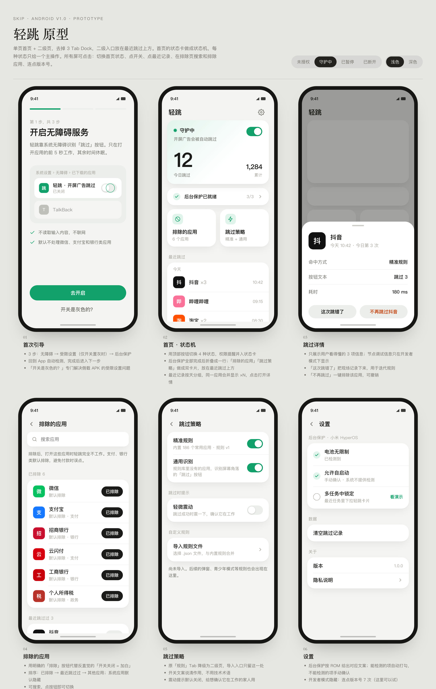
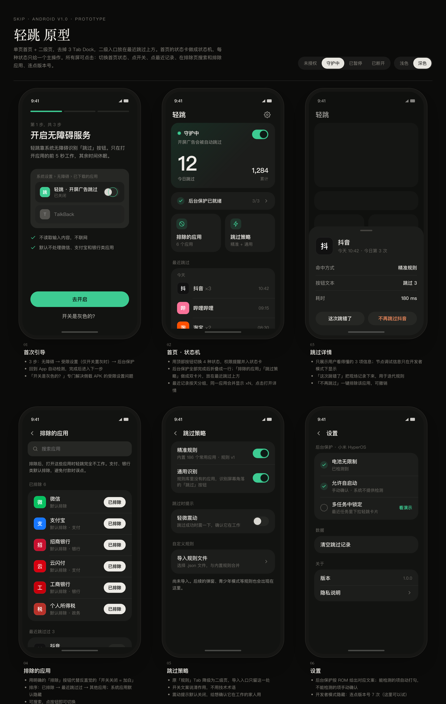

# 轻跳 (Skip)

一款极简、低功耗的 Android 开屏广告跳过工具，基于系统无障碍服务（`AccessibilityService`）实现。

## 下载与安装

前往 [Releases 页面](../../releases/latest) 下载最新的 `app-release.apk` 直接安装。

安装后按应用内引导开启「无障碍服务」即可使用；建议同时在系统电池设置中允许后台运行（忽略电池优化），避免被系统清理。

## 界面预览

| 浅色模式 | 深色模式 |
| :---: | :---: |
|  |  |

## 纯本地与隐私安全

本项目为**纯本地运行**的客户端应用，没有任何后端服务，不存在个人隐私泄露风险：

- **无服务端、无账号、无埋点**：不依赖任何业务后端接口，未集成任何第三方统计、广告或崩溃上报 SDK。
- **后台无障碍零联网**：无障碍服务进程（`:service`）100% 本地离线运行，所有规则、白名单与跳过记录均仅保存在设备本地；网络权限仅用于用户在「设置 › 检查更新」中手动检查与下载新版本安装包。
- **最小化无障碍检测**：仅在切换应用后的前 10 秒窗口内（支持自定义时长）匹配“跳过”按钮，不读取、不记录、不保存任何用户输入内容或业务页面数据。
- **默认排除敏感应用**：微信、支付宝、银行、政务等应用默认排除，不在这些应用内触发任何检测或点击。

## 特性

- **低功耗设计**：仅在切换应用后的前 10 秒窗口内（可自定义 1–60 秒）检测“跳过”按钮，其余时间保持休眠；无障碍服务独立运行在轻量 `:service` 进程，不常驻加载 Compose UI 内存。
- **应用内远程更新**：支持在「设置 › 检查更新」中从云端通道检查、校验（SHA-256 + 签名证书）并覆盖安装更新。
- **内置常用规则**：内置常见国内应用开屏跳过规则（见 `app/src/main/assets/default_rules.json`），支持白名单与自定义规则管理。
- **轻量反馈**：可选开启跳过成功时的轻微震动反馈。

## 权限说明

应用仅申请实现核心功能所需的最小权限：

| 权限 | 用途 |
| :--- | :--- |
| 无障碍服务 (`BIND_ACCESSIBILITY_SERVICE`) | 在应用切换时识别并自动点击开屏页的“跳过”按钮 |
| 读取已安装应用列表 (`QUERY_ALL_PACKAGES`) | 在应用内展示已安装应用，用于管理白名单 |
| 忽略电池优化 (`REQUEST_IGNORE_BATTERY_OPTIMIZATIONS`) | 降低后台保活被系统清理的概率 |
| 震动 (`VIBRATE`) | 可选的跳过成功震动反馈 |
| 网络与安装更新 (`INTERNET` / `REQUEST_INSTALL_PACKAGES`) | 仅用于用户在「设置 › 检查更新」中手动检查、下载并调起系统安装器覆盖更新 |

## 环境要求与构建

- **JDK**: 17
- **Android SDK**: `compileSdk 36` / `minSdk 26` (Android 8.0+)
- **技术栈**: Kotlin + Jetpack Compose + Material 3

### 本地构建

```bash
# 构建 Debug APK
./gradlew assembleDebug

# 构建 Release APK（未配置正式签名时自动回退为 debug 签名）
./gradlew assembleRelease
```

### 配置正式 Release 签名

在项目根目录创建 `keystore.properties`（已加入 `.gitignore`，不会提交到仓库）：

```properties
storeFile=release.jks
storePassword=your_store_password
keyAlias=your_key_alias
keyPassword=your_key_password
```

或在 CI 中通过环境变量注入：`KEYSTORE_FILE`、`KEYSTORE_PASSWORD`、`KEY_ALIAS`、`KEY_PASSWORD`。

### GitHub Actions 自动发布

仓库内置 `.github/workflows/build.yml`：
- 推送到 `main` 或发起 PR 时自动编译 Debug APK 验证构建。
- 推送 `v*` 标签（如 `v1.0.0`）时自动构建 Release APK 并创建 GitHub Release。如需使用正式签名发布，请在仓库 Settings → Secrets 中配置 `SIGNING_KEY`（`.jks` 文件的 Base64 编码）、`KEYSTORE_PASSWORD`、`KEY_ALIAS`、`KEY_PASSWORD`。

## 免责声明

本项目仅供学习与个人日常辅助使用。请勿将其用于任何违反相关法律法规或第三方服务条款的用途。

## 开源协议

基于 [MIT License](LICENSE) 开源。
